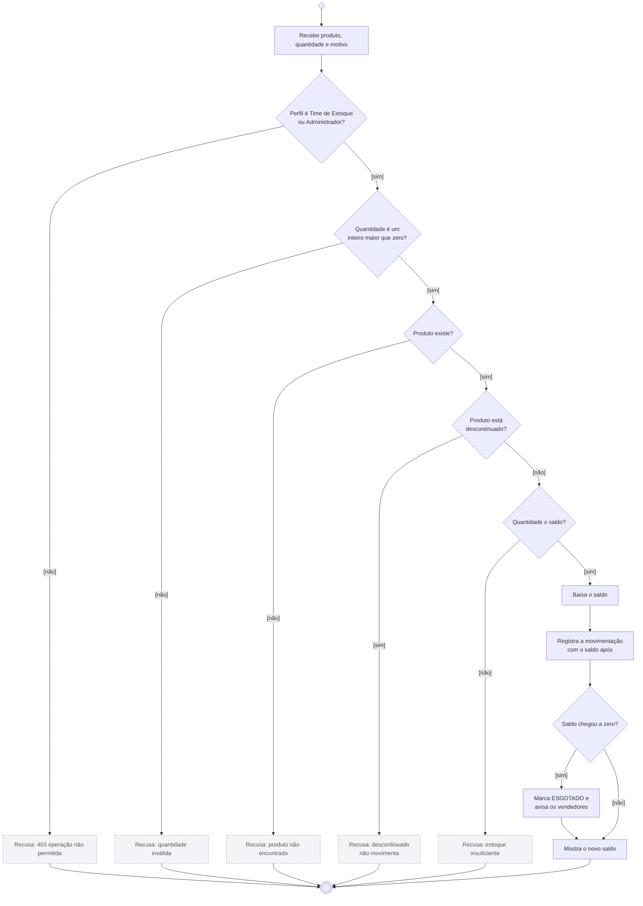

# Atividades — Registrar uma saída de estoque

**Pergunta:** quais passos e decisões o sistema percorre até aceitar ou recusar uma saída?

O diagrama de sequência mostra **quem** faz cada parte. Este mostra **todas as condições**: cada losango é uma regra, e cada recusa tem o seu caminho.

## Leitura

| Elemento   | Onde aparece                                                       |
| ---------- | ------------------------------------------------------------------ |
| Nó inicial | O círculo no topo                                                  |
| Ações      | "Baixa o saldo", "Registra a movimentação" etc.                    |
| Decisões   | Seis losangos, cada um com `[sim]` / `[não]`                       |
| Nó final   | Um só, onde todos os caminhos terminam, inclusive as cinco recusas |

**Ordem das decisões:** primeiro o que não exige banco (perfil, formato da quantidade), depois o que exige ler o produto (existe? descontinuado? saldo?). Um pedido inválido é recusado antes de qualquer consulta.

**Cada losango tem um teste** em `EstoqueIntegrationTests` ou `ProdutoTest`. Por exemplo, `vendedorNaoMovimentaNemCadastraNemDescontinua`, `quantidadeInvalidaViraMensagemDeErro`, `produtoDescontinuadoNaoMovimenta` e `saidaMaiorQueOSaldoNaoAlteraNada`.
