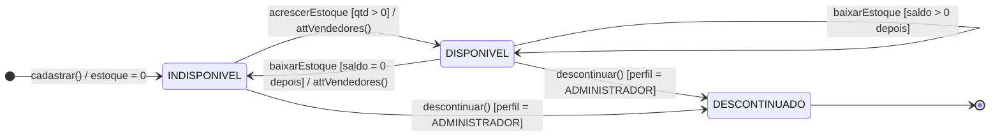

# Estados — Ciclo de vida do Produto

**Pergunta:** em que estado o produto está e quais eventos o fazem mudar?

Cada seta corresponde a um método da entidade `Produto` e a um teste em `ProdutoTest`.

## Do diagrama para o código

| Seta                                      | Método                                                                                  | Ação executada                                 |
| ----------------------------------------- | --------------------------------------------------------------------------------------- | ---------------------------------------------- |
| `[*] → INDISPONIVEL`                      | `Produto.cadastrar(nome, descricao, preco)`: nasce com estoque 0                        | —                                              |
| `INDISPONIVEL → DISPONIVEL`               | `acrescerEstoque(qtd)` devolve `Transicao.FICOU_DISPONIVEL`                             | `AvisosAosVendedores.produtoFicouDisponivel`   |
| `DISPONIVEL → INDISPONIVEL`               | `baixarEstoque(qtd)` devolve `Transicao.FICOU_INDISPONIVEL`                             | `AvisosAosVendedores.produtoFicouIndisponivel` |
| `DISPONIVEL/INDISPONIVEL → DESCONTINUADO` | `descontinuar()`, chamado só por `ProdutoService.descontinuar` com perfil Administrador | —                                              |

## Regras que o diagrama deixa explícitas

- **Todo produto nasce `INDISPONIVEL`, com estoque 0.** O cadastro não recebe quantidade: o saldo só entra por uma movimentação de entrada, que fica registrada no histórico.
- **DESCONTINUADO é final.** Não há seta saindo dele: o produto não volta a ser vendido nem movimentado, e qualquer `acrescerEstoque`/`baixarEstoque` lança exceção. Também não é apagado, para preservar o histórico de movimentações.
- **Não existe "INDISPONIVEL → INDISPONIVEL por baixa".** Baixar estoque de um produto com saldo 0 é impossível, porque a condição `qtd ≤ saldo` falha. Por isso a seta não existe.
- **A condição `[perfil = ADMINISTRADOR]`** não é sobre o produto, mas sobre quem dispara o evento. Por isso fica no `ProdutoService`, e não na entidade.
- **O status não tem setter.** Só as transições mudam o status, então o banco nunca tem um produto `DISPONIVEL` com saldo 0.
