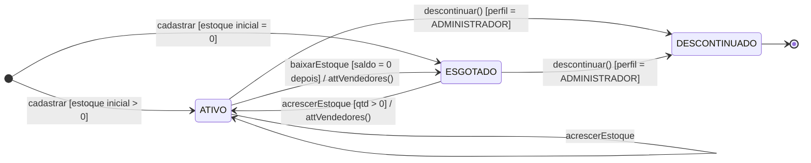

# Estados — Ciclo de vida do Produto

**Pergunta:** em que estado o produto está e quais eventos o fazem mudar?

Este é o diagrama "Status do Product" da aula, implementado. Cada seta corresponde a um método da entidade `Produto` e a um teste em `ProdutoTest`.

## Do diagrama para o código

| Seta                             | Método                                                                                  | Ação executada                               |
| -------------------------------- | --------------------------------------------------------------------------------------- | -------------------------------------------- |
| `[*] → ATIVO / ESGOTADO`         | `Produto.cadastrar(..., estoqueInicial)`                                                | —                                            |
| `ATIVO → ESGOTADO`               | `baixarEstoque(qtd)` devolve `Transicao.ESGOTOU`                                        | `AvisosAosVendedores.produtoEsgotou`         |
| `ESGOTADO → ATIVO`               | `acrescerEstoque(qtd)` devolve `Transicao.VOLTOU_AO_ESTOQUE`                            | `AvisosAosVendedores.produtoVoltouAoEstoque` |
| `ATIVO/ESGOTADO → DESCONTINUADO` | `descontinuar()`, chamado só por `ProdutoService.descontinuar` com perfil Administrador | —                                            |

## Regras que o diagrama deixa explícitas

- **DESCONTINUADO é final.** Não há seta saindo dele: o produto não volta a ser vendido nem movimentado, e qualquer `acrescerEstoque`/`baixarEstoque` lança exceção. Também não é apagado, para preservar o histórico de movimentações.
- **Não existe "ESGOTADO → ESGOTADO por baixa".** Baixar estoque de um produto esgotado é impossível, porque a condição `qtd ≤ saldo` falha com saldo 0. Por isso a seta não existe.
- **A condição `[perfil = ADMINISTRADOR]`** não é sobre o produto, mas sobre quem dispara o evento. Por isso fica no `ProdutoService`, e não na entidade.
- **O status não tem setter.** Só as transições mudam o status, então o banco nunca tem um produto `ATIVO` com saldo 0.
