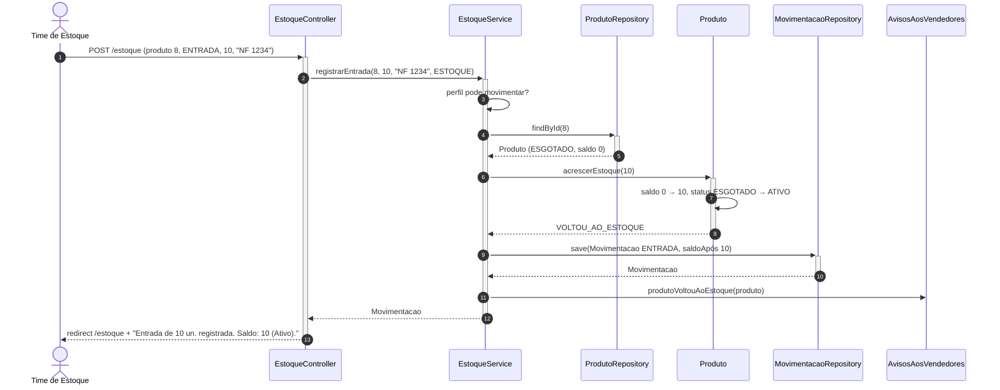

# Sequência — Entrada de estoque

**Pergunta:** quem chama quem, e em que ordem, quando o Time de Estoque registra a chegada de mercadoria?

Caso escolhido: o produto estava **ESGOTADO** e volta a ter saldo. É o caso que mais mostra colaboração, porque além de gravar a movimentação o sistema avisa os vendedores (`attVendedores()` no diagrama de estados).

## Leitura

- **Quem decide o status é o `Produto`** (passos 6 e 7), não o service nem o controller. O service só pergunta o que mudou (`Transicao`) para decidir se avisa alguém.
- **Tudo dentro de uma transação** (`@Transactional` no `EstoqueService`): o novo saldo do produto e o registro da movimentação são gravados juntos ou nenhum dos dois.
- **A permissão é checada no service** (passo 3), e não só na tela. Mesmo chamando a rota direto, o Vendedor recebe 403.
