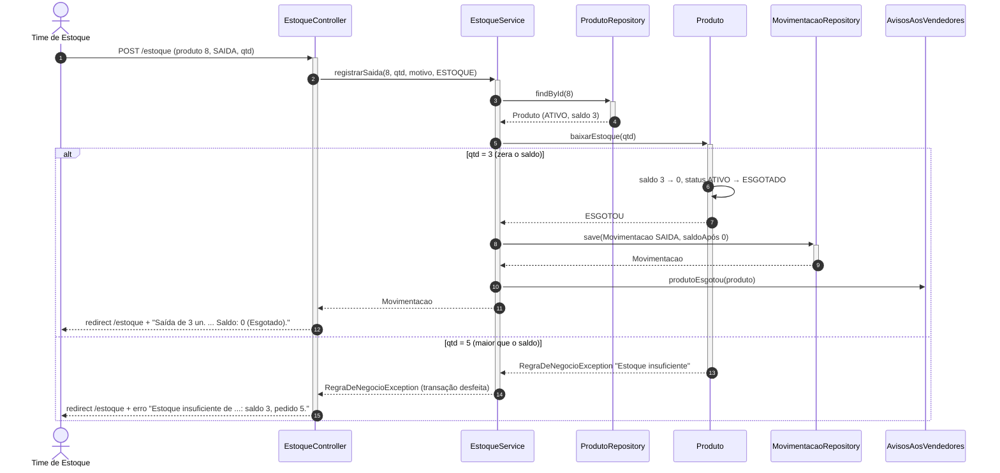

# Sequência — Saída de estoque

**Pergunta:** quem chama quem quando o Time de Estoque dá baixa em mercadoria (venda no balcão, avaria, devolução ao fornecedor)?

Aqui aparecem os dois desfechos que importam: a saída que **zera o saldo** (o produto esgota e os vendedores são avisados) e a saída **maior que o saldo** (recusada sem gravar nada).

## Leitura

- **A validação de saldo mora no `Produto`.** Nenhum outro lugar faz `quantidade - x`. Por isso não existe caminho que deixe o saldo negativo.
- **No caminho de erro, nada é gravado:** a exceção sai do `Produto` antes do `save` da movimentação, e a transação do service é desfeita.
- **Saída de produto descontinuado** segue o mesmo caminho do `else`, com a mensagem "está descontinuado". Ela aparece no diagrama de atividades ao lado, que é melhor para mostrar várias recusas.
