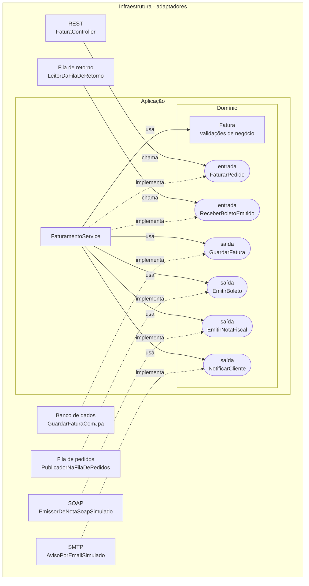
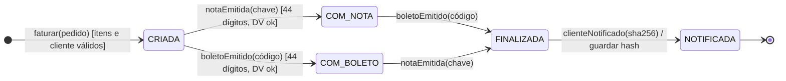
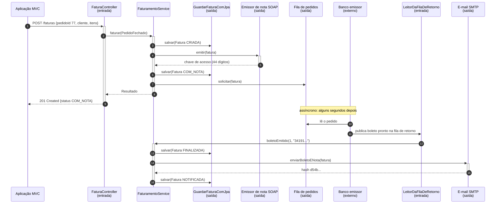

# Aula 7 — Arquitetura hexagonal

**Hub de Integração** que fatura os pedidos fechados na aplicação de vendas (MVC), construído com **portas e adaptadores** em Spring Boot. Projeto em [hub-faturamento/](hub-faturamento/).

## O problema

Um pedido fechado precisa ser faturado, e isso envolve conversar com sistemas diferentes, cada um por um protocolo:

| Conversa                                    | Sentido   | Protocolo       | Neste projeto                    |
| ------------------------------------------- | --------- | --------------- | -------------------------------- |
| A aplicação MVC manda o pedido fechado      | **entra** | REST            | `FaturaController`               |
| O emissor de boleto devolve o boleto pronto | **entra** | fila de retorno | `LeitorDaFilaDeRetorno`          |
| Pedir o boleto ao emissor                   | sai       | fila de pedidos | `PublicadorNaFilaDePedidos`      |
| Emitir a nota fiscal                        | sai       | SOAP            | `EmissorDeNotaSoapSimulado`      |
| Enviar boleto e nota ao cliente             | sai       | SMTP            | `AvisoPorEmailSimulado`          |
| Guardar a fatura                            | sai       | SQL             | `GuardarFaturaComJpa` (JPA + H2) |

## Requisitos atendidos

| Requisito                                                               | Como                                                                                                                                                      | Onde                                                                           |
| ----------------------------------------------------------------------- | --------------------------------------------------------------------------------------------------------------------------------------------------------- | ------------------------------------------------------------------------------ |
| **RF01**: criar e persistir a fatura e devolver o ID por REST           | `POST /faturas` com pedido, cliente e itens → `201` com o ID (e a fatura)                                                                                 | `FaturaController` → `FaturarPedido` → `GuardarFatura`                         |
| **RF02**: emitir o boleto **por fila** e guardar o código de barras     | Pedido na fila de pedidos, resposta na fila de retorno; código de **44 dígitos** com DV módulo 11 (layout FEBRABAN) validado pela entidade                | `PublicadorNaFilaDePedidos`, `LeitorDaFilaDeRetorno`, `Fatura.registrarBoleto` |
| **RF03**: emitir a nota fiscal **por SOAP** e guardar a chave           | Envelope SOAP montado no adaptador e `<chNFe>` lido da resposta; chave de acesso de **44 dígitos** com DV módulo 11 (layout SEFAZ) validada pela entidade | `EmissorDeNotaSoapSimulado`, `Fatura.registrarNotaFiscal`                      |
| **RF04**: notificar o cliente **por SMTP** e guardar o hash do conteúdo | Mensagem SMTP com boleto e chave da NF-e; **SHA-256** (64 hex) do conteúdo guardado na fatura                                                             | `AvisoPorEmailSimulado`, `Fatura.registrarClienteNotificado`                   |

As regras de DV ficam em `dominio/fatura/DigitoVerificador`. São regras de negócio (FEBRABAN e SEFAZ), não detalhes de tecnologia, e por isso ficam no domínio. O DV da chave foi conferido com o exemplo do manual da NF-e em `DigitoVerificadorTest`.

**Por que não MVC?** O Hub não tem tela, então a View ficaria sem uso. O Controller só sabe receber HTTP, mas o boleto chega por fila. E fila, SOAP e SMTP acabariam misturados com as regras de faturamento dentro do Service. A hexagonal troca o "em cima e embaixo" do MVC por **dentro e fora**: as regras ficam no centro, e cada protocolo vira um adaptador na borda.

> Os sistemas externos (fila, SOAP, SMTP) são **simulados**, para o projeto rodar sem instalar RabbitMQ nem servidor de e-mail. A simulação mora toda nos adaptadores. Trocar pela tecnologia real não muda uma linha do domínio nem da aplicação, e esse é o ponto da arquitetura.

## O hexágono deste projeto



Leitura do diagrama: **o domínio define as portas**. O serviço **implementa** as de entrada e **usa** as de saída. Os adaptadores da esquerda **chamam** as entradas, e os da direita **implementam** as saídas. Toda seta aponta para dentro.

## Estrutura de pacotes

```
br.com.hubfaturamento
├── dominio                                   ← só conhece a si mesmo
│   ├── fatura
│   │   ├── Fatura                    entidade: itens obrigatórios, valor total calculado,
│   │   │                             boleto e chave de 44 dígitos, hash SHA-256, transições de estado
│   │   ├── Cliente, ItemFaturado     validam nome, e-mail, CPF/CNPJ, quantidade e valor unitário
│   │   ├── DigitoVerificador         DV módulo 11 do código de barras (FEBRABAN) e da chave (SEFAZ)
│   │   ├── StatusFatura              CRIADA, COM_BOLETO, COM_NOTA, FINALIZADA, NOTIFICADA
│   │   └── FaturaInvalidaException
│   └── porta
│       ├── entrada                   o que o hub OFERECE
│       │   ├── FaturarPedido
│       │   └── ReceberBoletoEmitido
│       └── saida                     o que o hub PRECISA, nas palavras do negócio
│           ├── GuardarFatura
│           ├── EmitirBoleto
│           ├── EmitirNotaFiscal
│           ├── NotificarCliente
│           └── EmissorIndisponivelException
├── aplicacao                                 ← só conhece o domínio, sem anotação Spring
│   ├── FaturamentoService            implementa a entrada, usa a saída
│   └── FaturaNaoEncontradaException
├── infraestrutura                            ← toda dependência de tecnologia mora aqui
│   ├── entrada.rest                  FaturaController, TratadorDeErros
│   ├── entrada.fila                  LeitorDaFilaDeRetorno
│   ├── saida.persistencia            FaturaTabela (JPA), GuardarFaturaComJpa
│   ├── saida.fila                    PublicadorNaFilaDePedidos
│   ├── saida.soap                    EmissorDeNotaSoapSimulado
│   ├── saida.smtp                    AvisoPorEmailSimulado
│   ├── mensageria                    FilasEmMemoria (faz o papel do RabbitMQ)
│   └── configuracao                  ConfiguracaoDoHub: liga cada porta ao seu adaptador
└── simulacao                                 ← fora do hub: finge ser o banco emissor de boleto
    └── EmissorDeBoletoExterno
```

## Decisões de arquitetura

**1. As portas têm nomes do negócio, não da tecnologia.** É `NotificarCliente`, e não `EnviarEmail`; é `EmitirBoleto`, e não `PublicarNaFila`. O domínio sabe **o que** precisa, e o adaptador decide **como**. Se o aviso passar a ser por SMS, basta um novo adaptador para `NotificarCliente`.

**2. Duas portas de entrada, porque o mundo entra por dois lados.** A aplicação MVC entra por REST e chama `FaturarPedido`. O emissor de boleto responde pela fila e o `LeitorDaFilaDeRetorno` chama `ReceberBoletoEmitido`. Para o serviço tanto faz: as duas são só interfaces. É o adaptador de entrada que o MVC não tinha.

**3. O boleto é assíncrono e a nota é síncrona.** `EmitirBoleto.solicitar` não devolve nada, porque o código chega depois pela outra porta. `EmitirNotaFiscal.emitir` devolve a chave de acesso na hora. O contrato de cada porta reflete como o fornecedor funciona, sem expor a tecnologia.

**4. A entidade de domínio é diferente da linha da tabela.** `Fatura` não tem `@Entity`. Quem tem é `FaturaTabela`, na infraestrutura, e o adaptador traduz uma na outra. Isso permite trocar H2 por PostgreSQL, ou por MongoDB, sem tocar em regra nenhuma.

**5. A aplicação não conhece o Spring.** `FaturamentoService` é uma classe Java comum, montada pela `ConfiguracaoDoHub`, que fica na infraestrutura. É a regra de dependência levada ao pé da letra: a infraestrutura conhece a aplicação, e nunca o contrário.

**6. Regras do domínio x regras da aplicação** (os dois zooms dos slides):

| Regra                                                                                   | Onde                                             | Por quê                                             |
| --------------------------------------------------------------------------------------- | ------------------------------------------------ | --------------------------------------------------- |
| Fatura sem itens, sem cliente, com item de valor zero ou e-mail/CPF inválido não existe | `Fatura.criar`, `Cliente`, `ItemFaturado`        | Só depende da própria fatura                        |
| Código de barras e chave de acesso precisam ter 44 dígitos e DV correto                 | `Fatura.registrarBoleto` / `registrarNotaFiscal` | Regra FEBRABAN/SEFAZ, vale para qualquer fornecedor |
| Boleto e nota em qualquer ordem; só finaliza com os dois                                | `Fatura.registrarBoleto` / `registrarNotaFiscal` | É o diagrama de estados abaixo                      |
| O mesmo boleto chegando duas vezes não muda nada                                        | `Fatura.registrarBoleto`                         | Fila pode entregar repetido (Aula 8)                |
| O mesmo pedido enviado duas vezes devolve a fatura existente (HTTP 200)                 | `FaturamentoService.faturar`                     | Depende de consultar a porta `GuardarFatura`        |
| Emissor de nota fora do ar: a fatura nasce mesmo assim e fica aguardando a nota         | `FaturamentoService.faturar`                     | É o "emissor fora do ar?" do zoom na aplicação      |
| Servidor de e-mail fora do ar: a fatura fica `FINALIZADA`, não `NOTIFICADA`             | `FaturamentoService`                             | Idem                                                |
| Fatura inexistente → 404; regra violada → 422                                           | `TratadorDeErros` (REST)                         | Só o adaptador sabe o que é HTTP                    |

**7. A ordem dentro de `faturar` importa.** O pedido do boleto sai **por último**, depois de a fatura estar salva com a nota. Como o retorno chega por outra thread (a fila), se o pedido saísse antes o retorno poderia ler a fatura antiga e sobrescrever a nota. A Aula 8 mostra que salvar e publicar ainda são dois lugares, um problema que o padrão **outbox** resolve.

**8. A regra de dependência é verificada por teste.** `RegraDeDependenciaTest` lê os `import` de `dominio` e `aplicacao` e falha se aparecer `org.springframework`, `jakarta.*`, `org.hibernate`, `lombok` ou o pacote `infraestrutura`. "Conhecer quer dizer mencionar no código": se alguém quebrar a regra, o build acusa.

## Ciclo de vida da fatura

Boleto (fila) e nota (SOAP) chegam por caminhos diferentes e **em qualquer ordem**. A fatura só é finalizada com os dois, e só então o e-mail sai.



No caminho normal, a nota vem primeiro (SOAP é síncrono, dentro do `faturar`) e o boleto depois (fila). Com o emissor de nota fora do ar, a ordem se inverte e a fatura passa por `COM_BOLETO`. O código trata os dois caminhos. O cancelamento (`CANCELADA`), usado pela saga da Aula 8, está documentado em [aula-8/resiliencia.md](../aula-8/resiliencia.md) e não foi implementado aqui.

## O hub faturando um pedido



## Testes: por que a hexagonal facilita

| Teste                        | O que pluga nas portas                                                                                  | Banco ou Spring? |
| ---------------------------- | ------------------------------------------------------------------------------------------------------- | ---------------- |
| `FaturaTest` (8)             | nada: só a entidade                                                                                     | não              |
| `DigitoVerificadorTest` (3)  | nada: DV conferido com o exemplo do manual da NF-e                                                      | não              |
| `FaturamentoServiceTest` (7) | adaptadores **falsos** em memória: banco, fila, emissor de nota que pode "cair", e-mail que pode "cair" | não              |
| `HubFaturamentoApiTest` (3)  | adaptadores **reais**: REST, JPA + H2, filas, SOAP e SMTP simulados                                     | sim              |
| `RegraDeDependenciaTest` (2) | lê o código-fonte                                                                                       | não              |

O `FaturamentoServiceTest` mostra a ideia do Cockburn: para testar "e se o emissor de nota estiver fora do ar?", basta plugar um adaptador falso. Não é preciso banco no ar nem derrubar sistema nenhum.

## Executar

Requisito: JDK 21 ou superior. O Maven Wrapper baixa o Maven e as dependências no primeiro uso.

```powershell
cd aula-7/hub-faturamento
.\mvnw.cmd test                 # 23 testes
.\mvnw.cmd spring-boot:run      # sobe em http://127.0.0.1:8090
```

Faturando um pedido (PowerShell):

```powershell
$pedido = @'
{ "pedidoId": 77,
  "cliente": { "nome": "Ana Souza", "email": "ana@loja.com", "documento": "123.456.789-09" },
  "itens": [ { "descricao": "Caderno", "quantidade": 2, "valorUnitario": 19.90 },
             { "descricao": "Caneta", "quantidade": 10, "valorUnitario": 2.50 } ] }
'@
Invoke-RestMethod -Method Post -Uri http://127.0.0.1:8090/faturas -ContentType 'application/json' -Body $pedido
# status COM_NOTA. Espere uns 4 segundos (o banco emissor responde pela fila)...
Invoke-RestMethod http://127.0.0.1:8090/faturas/1
# status NOTIFICADA, valorTotal 64.80, codigoBarras (44), chaveNfe (44) e hashEmail (SHA-256).
# O envelope SOAP (em DEBUG) e a mensagem SMTP aparecem no console.
```

| Endpoint            | Respostas                                                                                       |
| ------------------- | ----------------------------------------------------------------------------------------------- |
| `POST /faturas`     | 201 fatura nova · 200 pedido já faturado (mesma fatura) · 422 regra violada · 400 JSON inválido |
| `GET /faturas/{id}` | 200 · 404                                                                                       |

Em `application.properties`, `hub.emissor-nota.fora-do-ar=true` simula o SOAP caído, e a fatura fica `COM_BOLETO` sem chave da NF-e. O console do H2 fica em <http://127.0.0.1:8090/h2-console> (JDBC URL `jdbc:h2:file:./data/hub`, usuário `sa`).

## MVC ou hexagonal?

O cadastro de produtos da [Aula 5](../aula-5/README.md) continua em MVC, e está certo assim: tem tela, entra pela web, sai para um banco e as regras são simples. O Hub vai para a hexagonal porque conversa com muitos sistemas, por vários protocolos, com fornecedores que mudam, e as regras precisam ser testadas isoladas. A escolha acompanha o problema.
