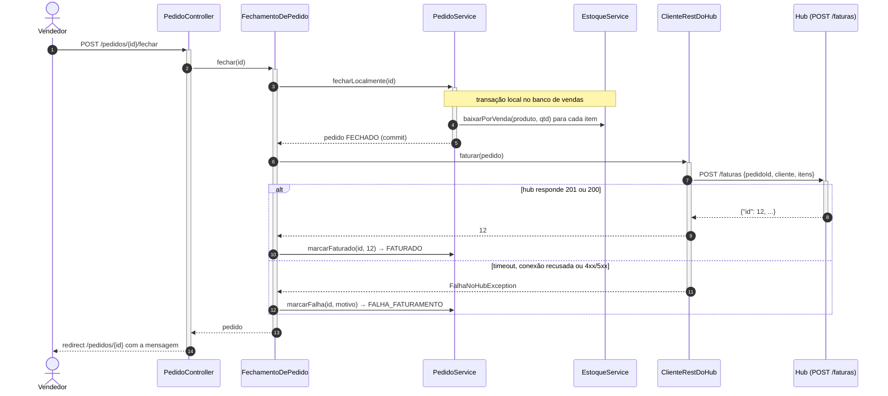

# Aula 8 — Integrando a venda ao hub de faturamento

A aplicação de vendas (MVC das Aulas 5 e 6) ganhou **pedidos de venda**. Ao **fechar um pedido**, ela baixa o estoque e chama o **hub de faturamento** da [Aula 7](../aula-7/README.md) por **REST**, guardando o **ID da fatura** devolvido. São dois sistemas, cada um com seu código, seu banco e seu processo, conversando pela rede: o estilo distribuído do início da aula.

## Entregas

| Item                                                                                 | Onde                                                                                                       |
| ------------------------------------------------------------------------------------ | ---------------------------------------------------------------------------------------------------------- |
| Aplicação de vendas integrada ao hub                                                 | [mvc/](mvc/)                                                                                               |
| **Análise dos problemas da integração e das soluções**                               | [analise.md](analise.md)                                                                                   |
| Material de estudo: o hub dividido em microsserviços (Cobrança, Fiscal, Notificação) | [c4-conteineres.md](c4-conteineres.md), [comunicacao.md](comunicacao.md), [resiliencia.md](resiliencia.md) |

## O que foi implementado



| Classe                                           | Papel                                                                                                                                                                        |
| ------------------------------------------------ | ---------------------------------------------------------------------------------------------------------------------------------------------------------------------------- |
| `model/Pedido`, `ItemPedido`, `StatusPedido`     | Pedido de venda com cliente (nome, e-mail, CPF/CNPJ), itens com preço do momento, status `ABERTO → FECHADO → FATURADO` ou `FALHA_FATURAMENTO`, `faturaId`, erro e tentativas |
| `service/PedidoService`                          | Operações **locais** em transações curtas: abrir, adicionar e remover item, fechar com baixa de estoque, marcar faturado ou falha                                            |
| `service/FechamentoDePedido`                     | **Orquestra**: fecha localmente e **só depois do commit** chama o hub. Não é `@Transactional` de propósito                                                                   |
| `integracao/ClienteDoHub` + `ClienteRestDoHub`   | Contrato e cliente REST (`RestClient`) com **timeout** de conexão e de leitura (`hub.timeout-ms`)                                                                            |
| `controller/PedidoController` + `view/pedidos/*` | Telas: abrir pedido, adicionar itens, fechar, ver a fatura e **Reenviar ao hub**                                                                                             |
| `service/EstoqueService.baixarPorVenda`          | A venda gera uma movimentação de saída "Pedido de venda #N", e o produto pode ficar indisponível (Aula 6)                                                                    |

### Contrato com o hub

```http
POST http://127.0.0.1:8090/faturas
Content-Type: application/json

{ "pedidoId": 1,
  "cliente": { "nome": "Ana Souza", "email": "ana@loja.com", "documento": "12345678909" },
  "itens":   [ { "descricao": "Caderno", "quantidade": 2, "valorUnitario": 19.90 } ] }

→ 201 Created  { "id": 1, "status": "COM_NOTA", ... }   (fatura nova)
→ 200 OK       { "id": 1, ... }                          (mesmo pedidoId de novo: mesma fatura)
→ 422          { "detail": "..." }                        (regra de negócio violada)
```

## Decisões de arquitetura

1. **A transação local não espera a rede.** Fechar o pedido e baixar o estoque é uma transação no banco de vendas. A chamada ao hub acontece **depois do commit**. Se a transação ficasse aberta durante a chamada, um hub lento travaria linhas do banco de vendas e a falha se espalharia.
2. **Síncrono, com limite.** A venda precisa do ID da fatura para mostrar ao vendedor (critério do slide: "preciso da resposta para continuar?"). Por isso é REST, mas com **timeout**: nunca esperar para sempre.
3. **Falha é um estado, não uma exceção engolida.** Se o hub não responde, o pedido fica `FALHA_FATURAMENTO` com o motivo, e a tela oferece **Reenviar ao hub**.
4. **O mesmo `pedidoId` sempre.** O reenvio manda o mesmo identificador, e o hub, que é **idempotente**, devolve a fatura existente em vez de criar outra.
5. **Preço congelado no item.** `ItemPedido` guarda descrição e preço do momento da venda. Mudar o preço do produto depois não altera pedidos já feitos nem o que foi faturado.
6. **Tudo ou nada no estoque.** Se um item não tem estoque suficiente, nenhum item é baixado, o pedido continua `ABERTO` e o hub nem é chamado.

Os problemas que essas decisões **ainda não resolvem**, e as soluções (circuit breaker, fila com outbox), estão em [analise.md](analise.md).

## Testes

```powershell
cd aula-8/mvc
.\mvnw.cmd test     # 27 testes
```

`IntegracaoComHubTests` sobe um **hub falso HTTP** dentro do teste e cobre: o caminho feliz (com o JSON enviado conferido), o hub derrubando a conexão e o reenvio, o hub lento (timeout de 500 ms), o hub recusando com 422, a falta de estoque (nada é baixado nem enviado), o produto ficando indisponível na última unidade e o fluxo pelas telas com perfis. Os testes da Aula 6 (`EstoqueIntegrationTests`, `ProdutoTest`) continuam passando.

## Executar os dois sistemas

```powershell
# terminal 1: o hub (Aula 7)
cd aula-7/hub-faturamento
.\mvnw.cmd spring-boot:run        # http://127.0.0.1:8090

# terminal 2: a venda (Aula 8)
cd aula-8/mvc
.\mvnw.cmd spring-boot:run        # http://127.0.0.1:8080
```

1. No topo, escolha **Administrador** e cadastre um produto com estoque.
2. Troque para **Vendedor**, vá em **Pedidos**, abra um pedido (nome, e-mail e CPF/CNPJ), adicione itens e clique em **Fechar pedido**.
3. O pedido fica **Faturado**, com o número da fatura e um link "ver no hub" (`GET /faturas/{id}`). Alguns segundos depois a fatura aparece `NOTIFICADA` no hub.

**Reproduzindo o problema 1:** pare o hub (`Ctrl+C` no terminal 1) e feche outro pedido. Ele fica _Falha no faturamento_, com o estoque já baixado. Suba o hub de novo e clique em **Reenviar ao hub**.

Conferi esse roteiro de ponta a ponta com os dois sistemas no ar. O pedido 1 foi faturado e a fatura chegou a `NOTIFICADA` no hub. Com o hub derrubado, o pedido 2 ficou em falha e foi faturado no reenvio.
