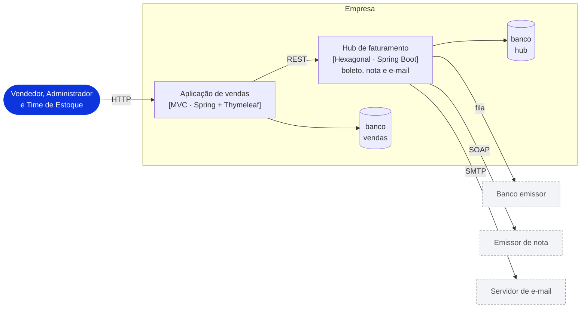
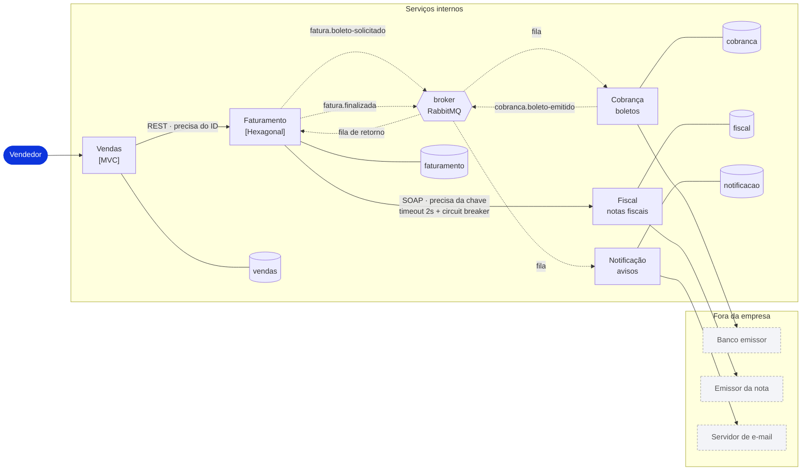

# C4 nível 2 — O ecossistema antes e depois da divisão

## Antes: dois sistemas, cada um com seu código, banco e processo



## Depois: o Hub dividido por responsabilidade de negócio

Seta cheia é síncrona. Seta tracejada é assíncrona, por fila.



## As quatro marcas, serviço por serviço

| Serviço     | Uma responsabilidade | Dado próprio  | Deploy independente | Conversa pela rede                                                    |
| ----------- | -------------------- | ------------- | ------------------- | --------------------------------------------------------------------- |
| Vendas      | pedidos e estoque    | `vendas`      | sim                 | chama o Faturamento por REST                                          |
| Faturamento | a fatura             | `faturamento` | sim                 | recebe REST; chama o Fiscal (SOAP); publica e consome filas           |
| Cobrança    | boletos              | `cobranca`    | sim                 | consome `fatura.boleto-solicitado`; publica `cobranca.boleto-emitido` |
| Fiscal      | notas fiscais        | `fiscal`      | sim                 | expõe SOAP; fala com o emissor externo                                |
| Notificação | avisos ao cliente    | `notificacao` | sim                 | consome `fatura.finalizada`; fala com o servidor de e-mail            |

**Teste de fronteira:** se eu mudar o banco de emissão de boletos (de um banco para outro), quais serviços são publicados? Só a **Cobrança**. Se a resposta fosse "Cobrança e Faturamento", a fronteira estaria errada.

## Contratos das mensagens

As filas são contratos públicos entre times. Cada mensagem carrega um `idMensagem` (para idempotência) e o `pedidoId` (para correlação nos logs).

```jsonc
// fila: fatura.boleto-solicitado   (publica: Faturamento · consome: Cobrança)
{ "idMensagem": "c1f7...", "pedidoId": 77, "faturaId": 42, "valor": 149.90, "vencimento": "2026-11-24" }

// fila: cobranca.boleto-emitido    (publica: Cobrança · consome: Faturamento)
{ "idMensagem": "9ab2...", "pedidoId": 77, "faturaId": 42, "codigoBarras": "34191000000000042000001499..." }

// fila: fatura.finalizada          (publica: Faturamento · consome: Notificação)
{ "idMensagem": "e04d...", "pedidoId": 77, "faturaId": 42, "emailCliente": "ana@loja.com",
  "codigoBarras": "34191...", "rps": "RPS-000042" }
```

A chamada síncrona ao Fiscal também tem contrato, que é o WSDL do serviço: `EmitirNota(faturaId, valor, cliente) → { rps, chaveAcesso }`.
