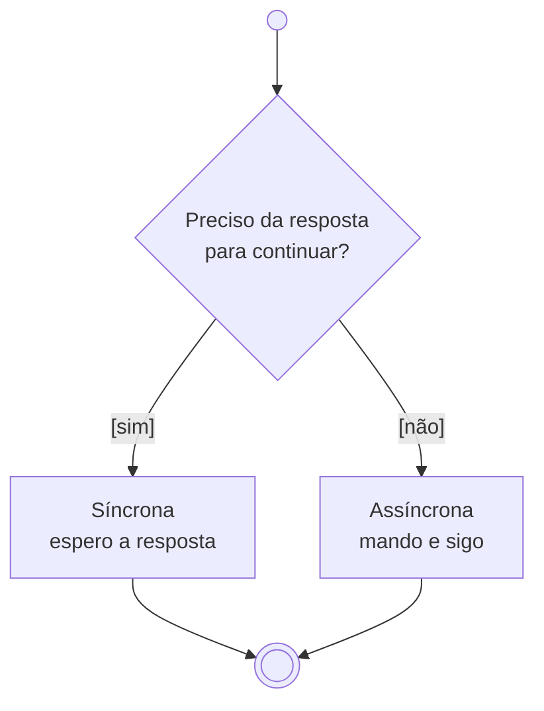
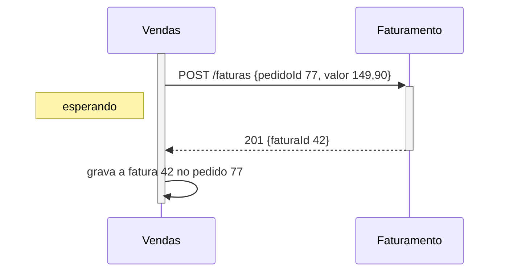
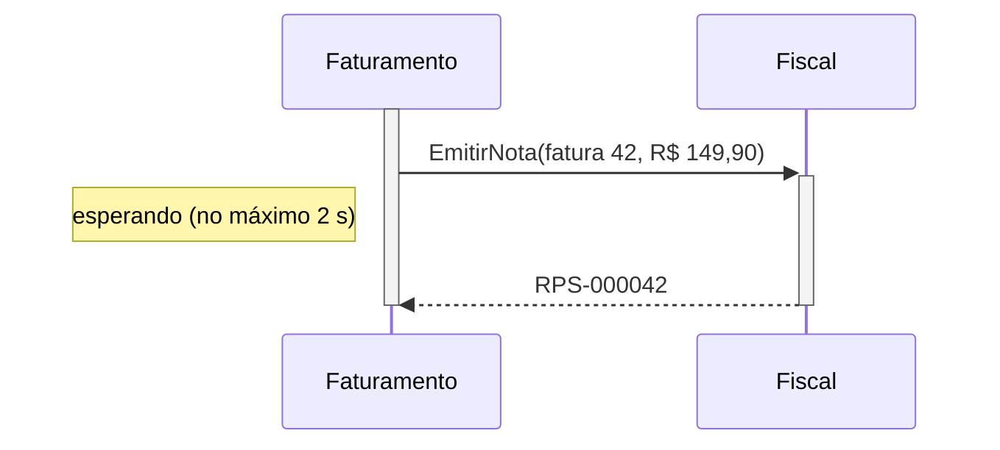
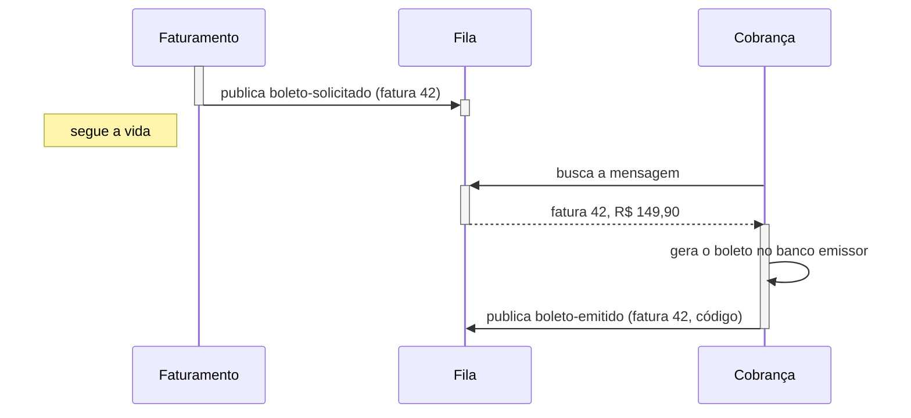
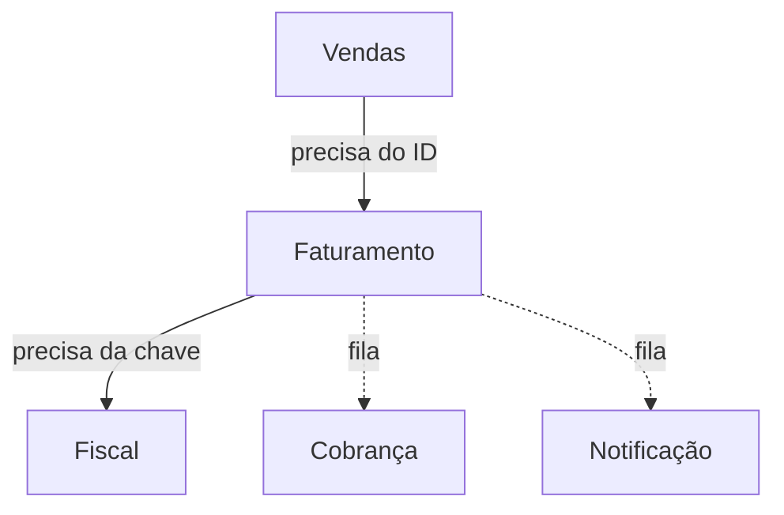

# Como os serviços conversam

Cada seta do C4 vira uma conversa pela rede. Antes de desenhar a seta, uma pergunta decide o tipo.

## O critério

|                 | Síncrona                                               | Assíncrona                                              |
| --------------- | ------------------------------------------------------ | ------------------------------------------------------- |
| Analogia        | uma **ligação**: você liga e espera a pessoa responder | um **recado**: você manda e vai fazer outra coisa       |
| Quem chama      | fica parado esperando                                  | publica e segue a vida                                  |
| Disponibilidade | os dois precisam estar no ar                           | o destino pode estar fora por um tempo, e a fila guarda |
| Tecnologias     | REST, SOAP                                             | fila (RabbitMQ)                                         |

## Síncrona: Vendas pede a fatura

Vendas precisa do **número da fatura** para mostrar ao vendedor e gravar no pedido. Sem a resposta, não termina o fechamento.

## Síncrona: Faturamento pede a nota ao Fiscal

A fatura precisa do **RPS/chave de acesso** da nota. É síncrona, e por isso é a seta mais perigosa: se o Fiscal demorar, o Faturamento demora, e Vendas também. É nela que entram o timeout e o circuit breaker de [resiliencia.md](resiliencia.md).

## Assíncrona: Faturamento pede o boleto à Cobrança

O Faturamento **não precisa** do código de barras para responder a Vendas. Publica o pedido e segue. A Cobrança busca quando puder, e devolve o boleto por outra fila.

## Assíncrona: a Notificação manda o e-mail

Quando a fatura fica finalizada (boleto + nota), o Faturamento publica `fatura.finalizada`. A Notificação manda o e-mail no seu ritmo. Se o servidor de e-mail estiver fora, a mensagem espera na fila e **o faturamento não para**.

## No nosso ecossistema

_Seta cheia: síncrona. Tracejada: assíncrona._

## Uma decisão que vale registrar

Na Aula 7, a porta `NotificarCliente` era **síncrona**: o Hub enviava o e-mail e recebia o hash na hora. Com a Notificação virando um microsserviço atrás de uma fila, ela vira **assíncrona**. O Faturamento não espera mais o e-mail sair. Ganhamos falha isolada (e-mail fora do ar não trava o faturamento) e pagamos com consistência eventual: por alguns segundos a fatura está `FINALIZADA`, mas ainda não `NOTIFICADA`.
