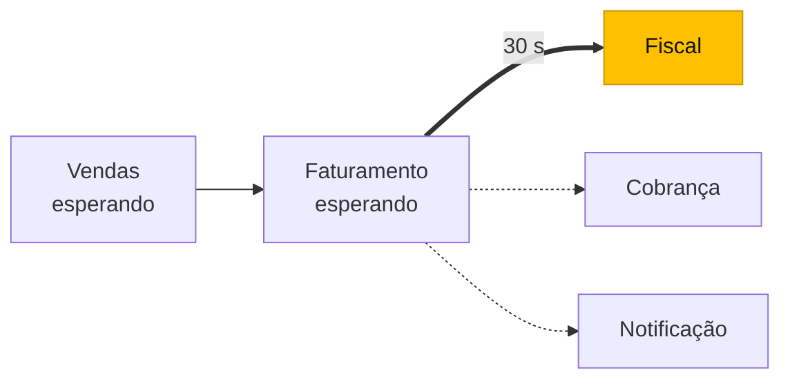
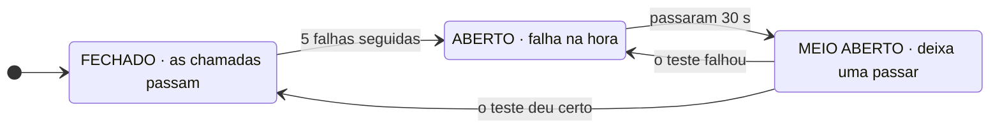
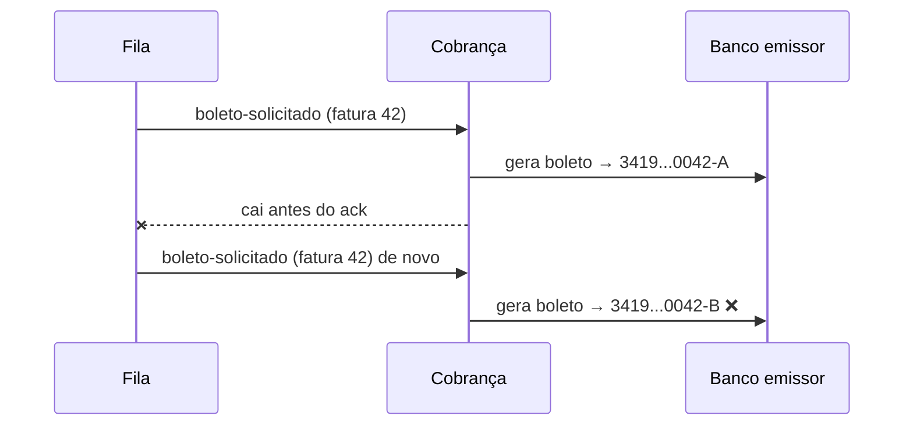
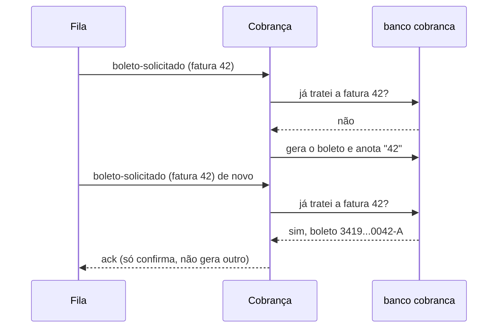
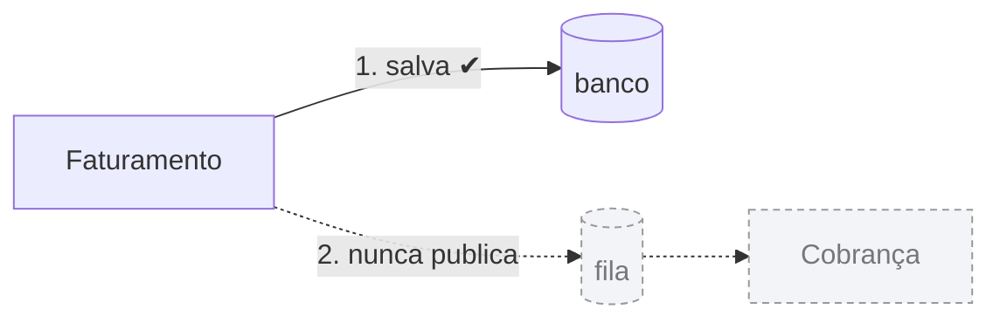
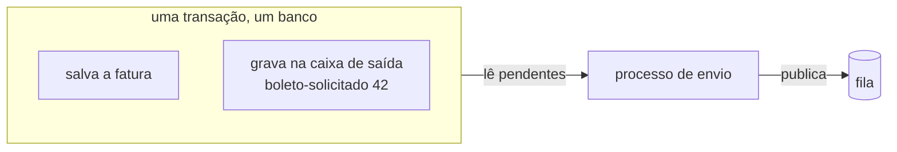
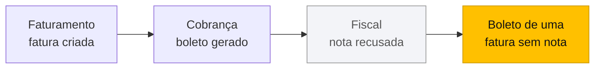
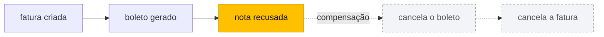
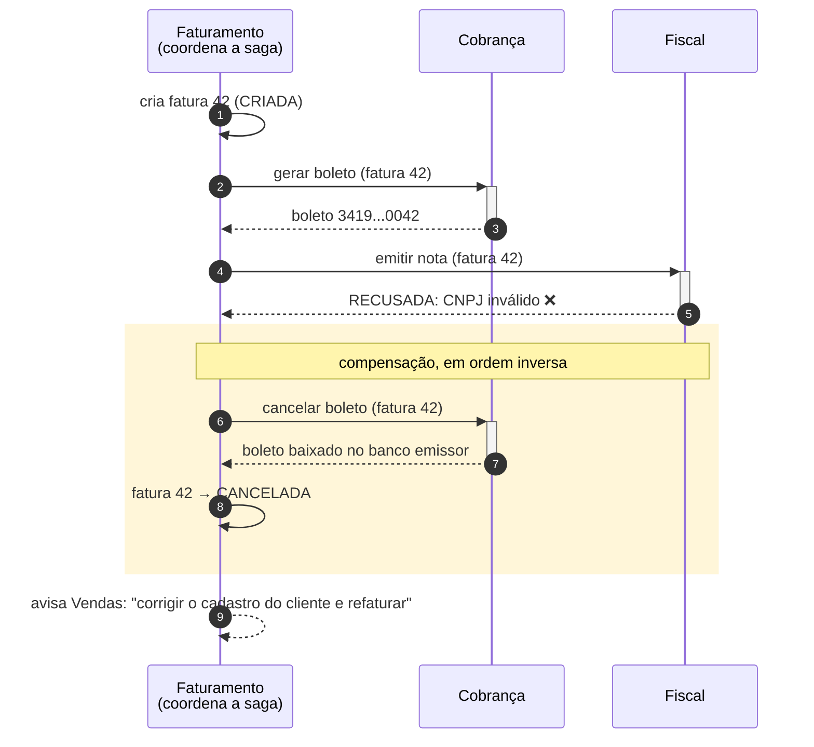

# O preço da rede — ameaças e soluções

Dentro de um processo, chamar outra parte é **chamar um método**: ele sempre responde, uma vez, e tudo cabe numa transação. Pela rede, cada seta pode falhar de três jeitos:

| #   | Ameaça                         | Na prática                                 | Soluções                                       |
| --- | ------------------------------ | ------------------------------------------ | ---------------------------------------------- |
| 1   | **Atrasar**                    | Quem espera fica parado                    | Timeout e circuit breaker                      |
| 2   | **Chegar duas vezes**          | Quem envia não sabe se deu certo, e repete | Idempotência                                   |
| 3   | **Não caber em uma transação** | O que deveria ser junto acontece separado  | Outbox (banco + fila) e saga (vários serviços) |

> Os trechos de código são ilustrativos e usam os nomes do Hub da Aula 7. Em produção eu usaria bibliotecas prontas: Resilience4j para timeout e circuit breaker, e Spring Modulith ou Debezium para outbox.

---

## Problema 1 — Atraso: o Fiscal demora a responder

Fim de mês, o emissor de notas da prefeitura fica lento e cada nota leva **30 segundos**. Em cadeia:

1. O Fiscal leva 30 s.
2. O Faturamento espera, porque precisa da chave para seguir.
3. Vendas espera o Faturamento, e o vendedor fica com a tela travada.



A culpa é do Fiscal, mas quem para é a venda. Isso é **falha em cascata**.

### Solução 1 — Timeout

Não esperar para sempre. O Faturamento chama o Fiscal com **limite de 2 s**. Passou disso, desiste: a fatura nasce **sem a nota** (o status `CRIADA`/`COM_BOLETO` da Aula 7) e o vendedor recebe a fatura sem travar.

```java
// adaptador de saída da porta EmitirNotaFiscal, agora falando com o microsserviço Fiscal
class ClienteDoServicoFiscal implements EmitirNotaFiscal {

    private final HttpClient http = HttpClient.newBuilder()
            .connectTimeout(Duration.ofSeconds(1))
            .build();

    @Override
    public String emitir(Fatura fatura) throws EmissorIndisponivelException {
        HttpRequest req = HttpRequest.newBuilder(URI.create(urlFiscal + "/notas"))
                .timeout(Duration.ofSeconds(2))                          // ← o limite
                .POST(BodyPublishers.ofString(json(fatura)))
                .build();
        try {
            return lerRps(http.send(req, BodyHandlers.ofString()));
        } catch (HttpTimeoutException e) {
            throw new EmissorIndisponivelException("Fiscal não respondeu em 2 s");
        } catch (IOException | InterruptedException e) {
            throw new EmissorIndisponivelException("Fiscal inacessível: " + e.getMessage());
        }
    }
}
```

Repare que o `FaturamentoService` da Aula 7 **já trata** `EmissorIndisponivelException` (a fatura nasce mesmo assim). O timeout só muda o adaptador.

**Limite do timeout:** o Fiscal continua com problemas, e **toda** chamada ainda gasta 2 s para falhar. Com 100 faturas por minuto, são 200 s de espera desperdiçada.

### Solução 2 — Circuit breaker

Se o Fiscal não está respondendo, **nem tenta** por um tempo: falha na hora, sem esperar.



```java
// envolve o adaptador com timeout: a chamada real só acontece se o circuito deixar
class FiscalComDisjuntor implements EmitirNotaFiscal {

    private enum Estado { FECHADO, ABERTO, MEIO_ABERTO }

    private final EmitirNotaFiscal fiscalReal;          // o ClienteDoServicoFiscal acima
    private Estado estado = Estado.FECHADO;
    private int falhasSeguidas;
    private Instant abertoDesde;

    @Override
    public synchronized String emitir(Fatura fatura) throws EmissorIndisponivelException {
        if (estado == Estado.ABERTO) {
            if (Instant.now().isBefore(abertoDesde.plusSeconds(30))) {
                throw new EmissorIndisponivelException("circuito aberto: nem tentei");
            }
            estado = Estado.MEIO_ABERTO;                // deixa uma passar
        }
        try {
            String rps = fiscalReal.emitir(fatura);
            estado = Estado.FECHADO;
            falhasSeguidas = 0;
            return rps;
        } catch (EmissorIndisponivelException e) {
            falhasSeguidas++;
            if (estado == Estado.MEIO_ABERTO || falhasSeguidas >= 5) {
                estado = Estado.ABERTO;
                abertoDesde = Instant.now();
            }
            throw e;
        }
    }
}
```

É um **decorador** da porta: o serviço continua vendo só `EmitirNotaFiscal`. As faturas que nasceram sem nota durante o circuito aberto são reenviadas depois, quando ele fecha.

---

## Problema 2 — Repetição: a Cobrança recebe o mesmo pedido duas vezes

1. A fila entrega o pedido de boleto da **fatura 42**, e a Cobrança gera o boleto no banco emissor.
2. A Cobrança **cai antes de avisar** a fila que terminou (antes do _ack_).
3. A fila, sem confirmação, **entrega a fatura 42 de novo**, e a Cobrança gera **outro boleto**.

O cliente recebe **dois boletos**. O timeout pode causar o mesmo: o Faturamento desistiu de esperar, mas o Fiscal emitiu. Se o Faturamento tentar de novo, saem duas notas.



### Solução — Idempotência

Fazer duas vezes dá o **mesmo resultado** que fazer uma. A Cobrança mantém a lista de **faturas já tratadas**: se a fatura já está lá, só devolve o boleto que já existe.



```java
@Transactional
public Boleto aoReceber(BoletoSolicitado msg) {
    return boletos.findByFaturaId(msg.faturaId())                 // já tratei?
        .orElseGet(() -> {
            String codigo = bancoEmissor.gerar(msg.faturaId(), msg.valor());
            return boletos.save(new Boleto(msg.faturaId(), codigo)); // anota
        });
}
// No banco: UNIQUE(fatura_id) na tabela de boletos.
// Duas entregas simultâneas: a segunda viola a restrição e não grava outro boleto.
```

O Hub da Aula 7 já faz isso nos dois lugares em que pode receber repetido:

- `Fatura.registrarBoleto` ignora o mesmo código chegando de novo pela fila de retorno.
- `FaturamentoService.faturar` devolve a fatura existente (HTTP 200) quando Vendas manda o mesmo pedido outra vez.

---

## Problema 3a — Banco e fila não cabem em uma transação

1. O Faturamento **salva a fatura** no seu banco. Tudo certo.
2. **Cai antes de publicar** o pedido de boleto na fila.
3. **Ninguém gera o boleto**: a Cobrança nem sabe que a fatura existe.

Banco e fila são **dois lugares**, e o "tudo ou nada" de uma transação só vale **dentro de um banco**. O `FaturamentoService.faturar` da Aula 7 tem exatamente esse ponto frágil: `faturas.salvar(...)` seguido de `boletos.solicitar(...)`.



### Solução — Outbox (caixa de saída)

1. **Grava junto**: a fatura e a mensagem vão para o **mesmo banco, na mesma transação**, numa tabela `caixa_de_saida`. Tudo ou nada.
2. **Envia depois**: um processo separado lê a caixa de saída e publica na fila.



```java
// adaptador de saída EmitirBoleto: em vez de publicar, grava na caixa de saída
@Transactional(propagation = Propagation.MANDATORY)   // precisa estar na mesma transação da fatura
public void solicitar(Fatura fatura) {
    caixaDeSaida.save(new MensagemPendente("fatura.boleto-solicitado", fatura.getId(), json(fatura)));
}

// processo de envio, separado
@Scheduled(fixedDelay = 1000)
public void enviarPendentes() {
    for (MensagemPendente m : caixaDeSaida.findTop100ByEnviadaEmIsNullOrderById()) {
        broker.publicar(m.fila(), m.conteudo());
        m.marcarEnviada();
        caixaDeSaida.save(m);
    }
}
```

Bônus: com o outbox, o cuidado de ordem da Aula 7 ("o pedido do boleto sai por último") deixa de ser necessário, porque a mensagem só fica visível quando a transação inteira confirma.

**E se cair no meio?** Entre publicar e marcar como enviada, a mensagem pode **sair duas vezes**. A **idempotência** da Cobrança resolve. Outbox e idempotência andam juntos: o outbox garante "pelo menos uma vez", e a idempotência transforma isso em "efeito de uma vez".

---

## Problema 3b — E quando são três serviços?



Cada serviço confirmou **no seu próprio banco**. Não há como voltar tudo de uma vez, e o cliente pode **pagar um boleto de uma venda que não tem nota fiscal**. A nota é recusada, por exemplo, quando o CPF/CNPJ do cliente é inválido na Receita.

### Solução — Saga

Uma **sequência de transações locais**. Se um passo falha, os anteriores são **desfeitos por compensação**, em ordem inversa.





```java
public void aoRecusarNota(NotaRecusada evento) {
    Fatura fatura = faturas.buscarPorId(evento.faturaId()).orElseThrow();
    if (fatura.getCodigoBarras() != null) {
        cobranca.cancelarBoleto(fatura.getId());   // compensa o passo 2 (idempotente)
    }
    fatura.cancelar("Nota recusada: " + evento.motivo());   // compensa o passo 1
    faturas.salvar(fatura);
}
```

É a analogia da viagem: o voo já foi reservado, o hotel não tem vaga, então você **cancela o voo**.

Decisões tomadas na saga:

- **Desfazer não é apagar.** A fatura não é deletada: vira `CANCELADA` (o estado previsto no diagrama de estados da fatura, no README da Aula 7), e o boleto é **baixado** no banco, não sumido. A história fica registrada.
- **Compensações também são idempotentes.** Cancelar o boleto da fatura 42 duas vezes tem o mesmo efeito que cancelar uma.
- **Quem coordena é o Faturamento** (saga **orquestrada**), porque ele já é o dono da fatura e sabe em que passo ela está. A alternativa, em que cada serviço reage a eventos sem um coordenador (**coreografia**), é o tema da Aula 9.
- **Consistência eventual.** Até a saga terminar, os serviços ficam um tempo em desacordo: a Cobrança acha que o boleto está ativo enquanto o Faturamento já sabe que a nota foi recusada.

---

## Resumo

| Ameaça            | Sintoma no ecossistema               | Solução         | O que custa                                                           |
| ----------------- | ------------------------------------ | --------------- | --------------------------------------------------------------------- |
| Atrasar           | Fiscal lento trava a venda (cascata) | Timeout         | Cada falha ainda gasta o limite                                       |
|                   |                                      | Circuit breaker | Durante o circuito aberto, ninguém tenta, mesmo se o Fiscal já voltou |
| Chegar duas vezes | Dois boletos para a mesma fatura     | Idempotência    | Tabela de controle e chave única                                      |
| Banco + fila      | Fatura salva, boleto nunca pedido    | Outbox          | Tabela extra, processo de envio, entrega possivelmente repetida       |
| Três serviços     | Boleto de uma fatura sem nota        | Saga            | Uma compensação por passo e consistência eventual                     |
